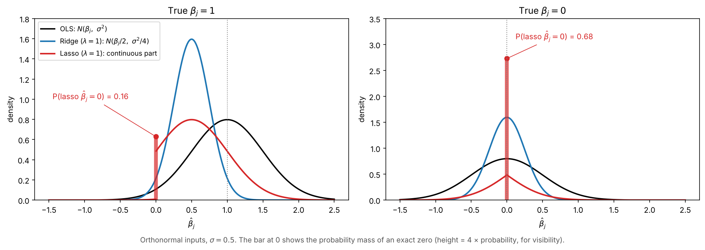
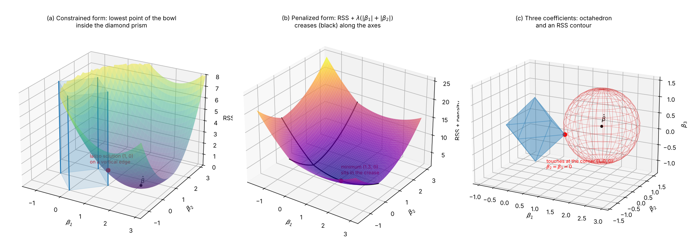
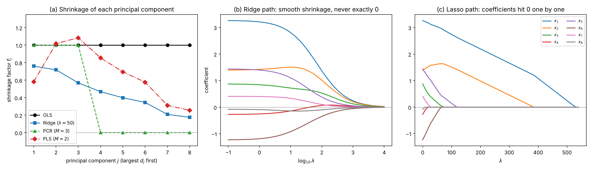

# Linear Regression Methods: OLS, Ridge, Lasso, PCR and PLS

**Summary.** All five methods fit a linear model $\hat y = X\hat\beta$. OLS minimizes the residual sum of squares; ridge and lasso add a penalty on $\beta$; PCR and PLS first build a few derived inputs $z_m = X v_m$ and regress $y$ on them. In the SVD basis of $X$, OLS, ridge and PCR differ only in how much they shrink each principal component; PLS uses $y$ to choose its directions. Algorithmically, OLS and PLS are both successive orthogonalization (Gram–Schmidt), PCR uses the SVD, ridge has a closed form, and lasso needs an iterative solver (coordinate descent or LARS).

## 1. Setting and notation

- $X$: $n \times p$ input matrix with **centred and standardized** columns $x_1, \dots, x_p$; $y$: centred response (so no intercept is needed).
- $\mathrm{RSS}(\beta) = \lVert y - X\beta \rVert_2^2 = \sum_{i=1}^n (y_i - x_i^\top \beta)^2$.
- SVD: $X = U D V^\top$, with $U = (u_1, \dots, u_p)$ ($n \times p$, orthonormal columns), $D = \mathrm{diag}(d_1 \ge \cdots \ge d_p \ge 0)$, $V = (v_1, \dots, v_p)$ ($p \times p$ orthogonal).
  - $v_j$: **principal component directions** (eigenvectors of $X^\top X = V D^2 V^\top$).
  - $z_j = X v_j = d_j u_j$: **principal components**, with sample variance $d_j^2 / n$.

Standardizing matters for ridge, lasso, PCR and PLS: their answers change if a variable is rescaled. OLS does not depend on the scaling.

## 2. The optimization problems

### 2.1. OLS

$$
\hat\beta^{\text{OLS}} = \arg\min_\beta \lVert y - X\beta \rVert_2^2
= (X^\top X)^{-1} X^\top y .
$$

- Normal equations: $X^\top (y - X\beta) = 0$, i.e. the residual is orthogonal to every column of $X$.
- Requires $X^\top X$ invertible ($p \le n$, no exact collinearity).

**Distribution of $\hat\beta$.** Assume $y = X\beta + \varepsilon$ with $X$ fixed and $\varepsilon \sim N(0, \sigma^2 I)$. $\hat\beta^{\text{OLS}}$ is linear in $y$, so

$$
\hat\beta^{\text{OLS}} \sim N\big(\beta,\ \sigma^2 (X^\top X)^{-1}\big).
$$

- **Unbiased**; by the Gauss–Markov theorem it has the smallest variance among linear unbiased estimators.
- With $\hat\sigma^2 = \mathrm{RSS}/(n - p - 1)$, $(n - p - 1)\hat\sigma^2/\sigma^2 \sim \chi^2_{n-p-1}$ independently of $\hat\beta$, so $t_j = \hat\beta_j \big/ \big(\hat\sigma \sqrt{[(X^\top X)^{-1}]_{jj}}\big) \sim t_{n-p-1}$ under $\beta_j = 0$.
- Without normal errors, the same holds approximately for large $n$ (central limit theorem).
- In the SVD basis, $\mathrm{Var}(\hat\beta) = \sigma^2 \sum_j v_j v_j^\top / d_j^2$: directions with small $d_j$ (collinearity) have very large variance.

### 2.2. Ridge regression

$$
\hat\beta^{\text{ridge}} = \arg\min_\beta \Big\lbrace  \lVert y - X\beta \rVert_2^2 + \lambda \lVert \beta \rVert_2^2 \Big \rbrace
= (X^\top X + \lambda I)^{-1} X^\top y .
$$

- **Constrained form** (Lagrange multiplier): $\min \lVert y - X\beta \rVert_2^2$ subject to $\sum_j \beta_j^2 \le t$; each $t$ corresponds to one $\lambda \ge 0$, which is the Lagrange multiplier of the constraint (2.7).
- $X^\top X + \lambda I$ is always invertible for $\lambda > 0$, even when $p > n$.
- **Bayes:** posterior mode (and mean) under $y \mid \beta \sim N(X\beta, \sigma^2 I)$, $\beta_j \sim N(0, \tau^2)$, with $\lambda = \sigma^2/\tau^2$.

**Distribution of $\hat\beta$.** $\hat\beta^{\text{ridge}} = (X^\top X + \lambda I)^{-1}X^\top y$ is still linear in $y$, so under the same model it is normal (for a fixed $\lambda$):

$$
\hat\beta^{\text{ridge}} \sim N\Big( (X^\top X + \lambda I)^{-1} X^\top X\, \beta,\ \ \sigma^2 (X^\top X + \lambda I)^{-1} X^\top X\, (X^\top X + \lambda I)^{-1} \Big).
$$

- **Biased toward 0:** $\mathrm{E}(\hat\beta^{\text{ridge}}) - \beta = -\lambda (X^\top X + \lambda I)^{-1}\beta$.
- In the SVD basis, along direction $v_j$ the mean is multiplied by $d_j^2/(d_j^2 + \lambda)$ and the variance is $\sigma^2 d_j^2/(d_j^2 + \lambda)^2$, instead of $\sigma^2/d_j^2$ for OLS: **smaller variance**, most reduced where $d_j$ is small.
- Bias–variance trade-off: for some $\lambda > 0$ the mean squared error is smaller than that of OLS (Hoerl and Kennard, 1970).
- Not to be confused with the **Bayesian posterior** $\beta \mid y \sim N\big(\hat\beta^{\text{ridge}},\ \sigma^2 (X^\top X + \lambda I)^{-1}\big)$, which describes uncertainty about $\beta$ rather than the sampling variability of $\hat\beta$.
- Because of the bias, and because $\lambda$ is usually chosen from the same data, the usual confidence intervals and p-values are not valid.

### 2.3. Lasso

$$
\hat\beta^{\text{lasso}} = \arg\min_\beta \Big\lbrace  \lVert y - X\beta \rVert_2^2 + \lambda \lVert \beta \rVert_1 \Big \rbrace,
\qquad \lVert \beta \rVert_1 = \sum_j |\beta_j| .
$$

- **Constrained form:** $\min \lVert y - X\beta \rVert_2^2$ subject to $\sum_j |\beta_j| \le t$. The constraint region has corners on the axes, so the solution often has **exact zeros** (variable selection). As for ridge, $\lambda$ is the multiplier of the constraint (2.7).
- Convex but not differentiable at $\beta_j = 0$: no closed form in general. The solution is characterized by the optimality (KKT) conditions in 2.4.
- **Bayes:** posterior **mode** under independent Laplace priors $p(\beta_j) \propto e^{-|\beta_j|/b}$.

**Distribution of $\hat\beta$.** $\hat\beta^{\text{lasso}}$ is **not** linear in $y$ and has no closed form, so its distribution is not normal: it is a **point mass at 0 plus a continuous part**.

**Orthonormal inputs** ($X^\top X = I$). Then $\tilde\beta_j = x_j^\top y \sim N(\beta_j, \sigma^2)$ independently, and $\hat\beta_j = S(\tilde\beta_j, \lambda/2)$ (soft thresholding, 2.4). Hence

$$
P(\hat\beta_j = 0) = P\big(\lvert\tilde\beta_j\rvert \le \tfrac{\lambda}{2}\big)
= \Phi\Big(\frac{\lambda/2 - \beta_j}{\sigma}\Big) - \Phi\Big(\frac{-\lambda/2 - \beta_j}{\sigma}\Big),
$$

and for $b \ne 0$ the density of $\hat\beta_j$ is the normal density shifted toward 0 by $\lambda/2$:

$$
f(b) = \frac{1}{\sigma}\,\varphi\Big(\frac{b + \tfrac{\lambda}{2}\mathrm{sign}(b) - \beta_j}{\sigma}\Big), \qquad b \ne 0 .
$$

- **Bias:** for large $\lvert\beta_j\rvert$, $\mathrm{E}(\hat\beta_j) \approx \beta_j - \tfrac{\lambda}{2}\mathrm{sign}(\beta_j)$; every non-zero estimate is shrunk by $\lambda/2$.
- In general (correlated inputs) the distribution depends on the whole design and is non-normal even asymptotically (Knight and Fu, 2000); the bootstrap is unreliable for coefficients near 0. Valid inference needs **post-selection** methods (selective inference, sample splitting) or the **debiased lasso**, which is approximately normal.

| True $\beta_j$ | | OLS | Ridge ($\lambda = 1$) | Lasso ($\lambda = 1$) |
|---|---|---|---|---|
| 1 | Mean of $\hat\beta_j$ | 1 | 0.5 | 0.54 |
| 1 | $P(\hat\beta_j = 0)$ | 0 | 0 | 0.16 |
| 1 | MSE | 0.25 | 0.31 | 0.40 |
| 0 | $P(\hat\beta_j = 0)$ | 0 | 0 | 0.68 |
| 0 | MSE | 0.25 | 0.06 | 0.04 |

(Orthonormal inputs, $\sigma = 0.5$; values from the formulas above, checked by simulation with 200,000 replicates.) OLS is unbiased with the largest spread; ridge shifts the whole normal curve toward 0 and narrows it; the lasso puts a spike at exactly 0 and shifts the rest by $\lambda/2$. Shrinkage pays off when the true coefficient is 0 (right) and costs bias when it is large (left).

**Why the lasso gives exact zeros: the geometry.**

- **(a) Constrained form.** The constraint $|\beta_1| + |\beta_2| \le t$ is a diamond; over the $(\beta_1, \beta_2)$ plane it is a prism with vertical edges above the corners. The lowest point of the RSS bowl inside the prism lies on a vertical edge, here at $(1, 0)$, so $\hat\beta_2 = 0$.
- **(b) Penalized form.** Adding $\lambda(|\beta_1| + |\beta_2|)$ to the smooth RSS bowl creates **creases** (black) along the axes $\beta_1 = 0$ and $\beta_2 = 0$, where the penalty is not differentiable. The minimum sits in a crease, at $(1.3, 0)$: this is exactly the subgradient condition of 2.4.
- **(c) Three coefficients.** The constraint region is an octahedron. The smallest RSS contour (ellipsoid) that touches it does so at a **corner**, $(1, 0, 0)$, so $\hat\beta_2 = \hat\beta_3 = 0$. In higher dimensions the corners and edges dominate even more, so sparse solutions are common.

In every view, the lasso's exact zeros come from **sharp features on the axes**: the edges of the prism, the creases of the penalized surface, the corners of the octahedron. Ridge has none of these, because its region $\sum_j \beta_j^2 \le t$ is round and its penalty is smooth, so the contour touches it at a generic point with all coordinates non-zero.

### 2.4. Lasso: optimality (KKT) conditions

**Why a special condition is needed.** For a differentiable convex function the minimum is where the gradient is zero. The lasso objective

$$
f(\beta) = \lVert y - X\beta \rVert_2^2 + \lambda \lVert \beta \rVert_1
$$

is convex, but $|\beta_j|$ has a corner at $\beta_j = 0$, so the gradient does not exist there. The gradient condition is replaced by a **subgradient** condition.

**Subgradient of $|b|$.** At a corner, any slope between the left and right derivatives is allowed:

$$
\partial |b| =
\begin{cases}
\lbrace +1 \rbrace & b \gt 0, \\
[-1,\ 1] & b = 0, \\
\lbrace -1 \rbrace & b \lt 0 .
\end{cases}
$$

> **Definition (KKT conditions).** Consider the constrained problem
>
> $$
> \min_{x}\ f(x) \quad \text{subject to} \quad g_i(x) \le 0\ \ (i = 1, \dots, m), \qquad h_k(x) = 0\ \ (k = 1, \dots, r),
> $$
>
> with Lagrangian $L(x, \mu, \nu) = f(x) + \sum_i \mu_i g_i(x) + \sum_k \nu_k h_k(x)$. A point $x^*$ with multipliers $\mu^*, \nu^*$ satisfies the **Karush–Kuhn–Tucker conditions** if
>
> 1. **Stationarity:** $0 \in \partial f(x^*) + \sum_i \mu_i^* \partial g_i(x^*) + \sum_k \nu_k^* \nabla h_k(x^*)$ (with gradients in place of subgradients when the functions are differentiable);
> 2. **Primal feasibility:** $g_i(x^*) \le 0$ and $h_k(x^*) = 0$;
> 3. **Dual feasibility:** $\mu_i^* \ge 0$;
> 4. **Complementary slackness:** $\mu_i^*\, g_i(x^*) = 0$ for every $i$: a multiplier can be positive only if its constraint is active ($g_i(x^*) = 0$).
>
> For a **convex** problem ($f$ and $g_i$ convex, $h_k$ affine) satisfying a mild regularity condition (e.g. Slater's condition: some strictly feasible point exists), the KKT conditions are **necessary and sufficient** for $x^*$ to be a global minimizer. Without constraints they reduce to stationarity alone, $0 \in \partial f(x^*)$ (or $\nabla f(x^*) = 0$). They generalize the Lagrange multiplier method, which handles only equality constraints.

**KKT conditions for the lasso.** The penalized lasso has no constraints, so by the definition above $\hat\beta$ is a minimizer if and only if $0 \in \partial f(\hat\beta)$:

$$
-2X^\top (y - X\hat\beta) + \lambda s = 0,
\qquad s_j \in \partial |\hat\beta_j| .
$$

Writing $\hat r = y - X\hat\beta$ for the residual, coordinate by coordinate:

| Case | Condition | Meaning |
|---|---|---|
| $\hat\beta_j \gt 0$ | $2x_j^\top \hat r = \lambda$ | Active, positive |
| $\hat\beta_j \lt 0$ | $2x_j^\top \hat r = -\lambda$ | Active, negative |
| $\hat\beta_j = 0$ | $\lvert 2x_j^\top \hat r\rvert \le \lambda$ | Inactive |

Because $f$ is convex, these conditions are **necessary and sufficient**. The constrained form, with complementary slackness, is treated in 2.7.

**Interpretation.** With standardized inputs, $x_j^\top \hat r$ is proportional to the correlation between $x_j$ and the residual.

- **Active variables** all have the **same** absolute correlation with the residual, $\lambda/2$, with the sign of their coefficient.
- **Inactive variables** have a smaller correlation: not enough to pay the penalty $\lambda$ for entering the model.
- Compare with OLS, where $x_j^\top \hat r = 0$ for every $j$ (normal equations), and with ridge, where $2x_j^\top \hat r = 2\lambda \hat\beta_j$: the correlation is proportional to $\hat\beta_j$, so it is zero only if $\hat\beta_j = 0$, and ridge has no reason to set coefficients exactly to zero.

**Consequences.**

**(1) All-zero solution and $\lambda_{\max}$.** $\hat\beta = 0$ (so $\hat r = y$) satisfies the KKT conditions if and only if $\lvert 2x_j^\top y\rvert \le \lambda$ for all $j$. Hence

$$
\hat\beta = 0 \iff \lambda \ge \lambda_{\max} = \max_j \lvert 2x_j^\top y\rvert .
$$

The lasso path starts here; the first variable to enter is the one most correlated with $y$.

**(2) Soft thresholding (one predictor).** With one standardized predictor scaled so that $x^\top x = 1$, let $\tilde b = x^\top y$ (the OLS estimate). The condition $-2(\tilde b - b) + \lambda s = 0$ gives three cases:

| Case | Solution | Valid when |
|---|---|---|
| $b \gt 0$ | $b = \tilde b - \lambda/2$ | $\tilde b \gt \lambda/2$ |
| $b \lt 0$ | $b = \tilde b + \lambda/2$ | $\tilde b \lt -\lambda/2$ |
| $b = 0$ | $b = 0$ | $\lvert\tilde b\rvert \le \lambda/2$ |

Together: $\hat b = S(\tilde b, \lambda/2) = \mathrm{sign}(\tilde b)\,(\lvert\tilde b\rvert - \lambda/2)_+$. **Coordinate descent** (see *Algorithms* below) applies exactly this to one coordinate at a time, with $y$ replaced by the partial residual; each update makes the KKT condition for that coordinate hold.

**(3) Piecewise-linear path.** Between the values of $\lambda$ where a variable enters or leaves, the active set $A$ and the signs $s_A$ are fixed, and the KKT equations for $A$ are linear:

$$
X_A^\top (y - X_A \beta_A) = \frac{\lambda}{2} s_A
\quad\Longrightarrow\quad
\hat\beta_A(\lambda) = (X_A^\top X_A)^{-1}\Big(X_A^\top y - \frac{\lambda}{2} s_A\Big),
$$

which is linear in $\lambda$. A variable **enters** when its $\lvert 2x_j^\top \hat r\rvert$ rises to $\lambda$ and **leaves** when its coefficient reaches 0. **LARS** follows the path by computing these events.

**(4) Checking a solution.** Software such as `glmnet` uses the KKT conditions to verify a computed solution and to screen out variables that are very likely inactive (the "strong rules").

**Numerical check** (the simulated example in *A unified view* below, $\lambda = 60$; here $\lambda_{\max} = 529.8$):

| $j$ | $\hat\beta_j$ | $2x_j^\top \hat r$ | Status |
|---|---|---|---|
| 1 | 2.990 | 60.0 | Active, $= \lambda$ |
| 2 | 1.638 | 60.0 | Active, $= \lambda$ |
| 3 | 0.079 | 60.0 | Active, $= \lambda$ |
| 4 | 0 | 18.4 | Inactive, $\le \lambda$ |
| 5 | 0.491 | 60.0 | Active, $= \lambda$ |
| 6 | −0.036 | −60.0 | Active, $= -\lambda$ |
| 7 | 0 | 19.3 | Inactive, $\le \lambda$ |
| 8 | 0 | −27.4 | Inactive, $\le \lambda$ |

The active coefficients also agree with the closed form $(X_A^\top X_A)^{-1}(X_A^\top y - \tfrac{\lambda}{2}s_A)$ for $A = \lbrace 1, 2, 3, 5, 6 \rbrace$.

### 2.5. Principal components regression (PCR)

Step 1: find directions that maximize the variance of $X$, ignoring $y$:

$$
v_m = \arg\max_{\alpha} \mathrm{Var}(X\alpha)
\quad \text{subject to } \lVert \alpha \rVert_2 = 1,\ \ \alpha^\top (X^\top X) v_\ell = 0 \ \ (\ell = 1, \dots, m-1).
$$

The solution is the $m$-th eigenvector of $X^\top X$, i.e. the $m$-th column of $V$ (derivation with Lagrange multipliers in 2.7).

Step 2: regress $y$ on the first $M$ components $z_m = X v_m$. They are orthogonal, so each coefficient is a simple regression:

$$
\hat\theta_m = \frac{\langle z_m, y \rangle}{\langle z_m, z_m \rangle},
\qquad
\hat y^{\text{PCR}}_{(M)} = \sum_{m=1}^M \hat\theta_m z_m,
\qquad
\hat\beta^{\text{PCR}}_{(M)} = \sum_{m=1}^M \hat\theta_m v_m .
$$

Equivalently, PCR is OLS **restricted to** $\beta \in \mathrm{span}\lbrace v_1, \dots, v_M \rbrace$. With $M = p$ it is OLS.

### 2.6. Partial least squares (PLS)

Step 1: find directions that have high variance **and** high correlation with $y$:

$$
\hat\varphi_m = \arg\max_{\alpha} \mathrm{Corr}^2(y, X\alpha)\,\mathrm{Var}(X\alpha) = \arg\max_\alpha \mathrm{Cov}^2(y, X\alpha)
\quad \text{subject to } \lVert \alpha \rVert_2 = 1,\ \ \alpha^\top (X^\top X)\hat\varphi_\ell = 0 \ \ (\ell = 1, \dots, m-1).
$$

The first direction is $\hat\varphi_1 \propto X^\top y$: the weight of $x_j$ is its inner product with $y$ (derivation in 2.7).

Step 2: regress $y$ on the orthogonal components $z_m = X\hat\varphi_m$, as in PCR.

**Krylov characterization.** The $M$-component PLS fit is OLS restricted to

$$
\beta \in \mathcal{K}_M = \mathrm{span}\lbrace X^\top y,\ (X^\top X) X^\top y,\ \dots,\ (X^\top X)^{M-1} X^\top y \rbrace.
$$

This is also what $M$ steps of the conjugate gradient method for the normal equations produce (checked numerically on the example below: identical coefficients). With $M = p$, PLS is OLS.

### 2.7. All five problems through Lagrange multipliers

Every method above is "optimize a quadratic subject to a constraint". Writing each with a Lagrangian shows where the solution, and the meaning of the multiplier, comes from. Notation: $S = X^\top X$, $c = X^\top y$.

**General recipe.** For $\min f(x)$ subject to $g(x) \le 0$ (or $= 0$), form $L(x, \mu) = f(x) + \mu\, g(x)$, set the (sub)gradient in $x$ to zero, and use the constraint and complementary slackness (definition in 2.4) to fix $\mu$. At the solution, $\mu$ is the **price of the constraint**: if the optimal value is $p^*(t)$ for a constraint $g(x) \le t$, then $dp^*/dt = -\mu$ (relaxing the constraint by $dt$ lowers the objective by $\mu\, dt$).

**OLS** (no constraint, $\mu = 0$).

$$
\min_\beta \lVert y - X\beta\rVert_2^2:
\qquad \nabla = -2X^\top(y - X\beta) = 0
\ \Longrightarrow\ S\hat\beta = c,\quad \hat\beta = S^{-1}c .
$$

**Ridge** (quadratic constraint).

$$
\min_\beta \lVert y - X\beta\rVert_2^2 \ \ \text{s.t.}\ \ \lVert\beta\rVert_2^2 \le t,
\qquad
L = \lVert y - X\beta\rVert_2^2 + \mu\big(\lVert\beta\rVert_2^2 - t\big).
$$

$$
\nabla_\beta L = -2c + 2S\beta + 2\mu\beta = 0
\ \Longrightarrow\ \hat\beta(\mu) = (S + \mu I)^{-1}c .
$$

- Complementary slackness: either $\lVert\hat\beta^{\text{OLS}}\rVert_2^2 \le t$ and $\mu = 0$, or the constraint is active, $\lVert\hat\beta(\mu)\rVert_2^2 = t$, which fixes $\mu \gt 0$ ($\lVert\hat\beta(\mu)\rVert_2^2$ decreases in $\mu$, so the solution is unique).
- The penalty $\lambda$ of the penalized form **is** the multiplier $\mu$. Numerical check on the simulated example: at $\mu = 50$, $-\,d\,\mathrm{RSS}/d\,\lVert\hat\beta\rVert_2^2 = 50.0$.

**Lasso** ($\ell_1$ constraint, subgradients).

$$
\min_\beta \lVert y - X\beta\rVert_2^2 \ \ \text{s.t.}\ \ \lVert\beta\rVert_1 \le t,
\qquad
L = \lVert y - X\beta\rVert_2^2 + \mu\big(\lVert\beta\rVert_1 - t\big).
$$

$$
0 \in -2c + 2S\beta + \mu\, \partial\lVert\beta\rVert_1
\ \Longleftrightarrow\
2x_j^\top(y - X\hat\beta) = \mu\, s_j,\quad s_j \in \partial\lvert\hat\beta_j\rvert .
$$

- Stationarity is the KKT condition of 2.4 with $\lambda = \mu$.
- Complementary slackness: $\mu\,(\lVert\hat\beta\rVert_1 - t) = 0$. If $t$ is large enough that the OLS solution is feasible, the constraint is inactive and $\mu = 0$ (no shrinkage); otherwise $\lVert\hat\beta\rVert_1 = t$ and $\mu \gt 0$. This is the precise sense in which each $t$ corresponds to a $\lambda$.
- No closed form; the corners of $\partial\lvert\beta_j\rvert$ at 0 produce exact zeros (2.4).

**PCR / PCA directions** (equality constraints).

$$
\max_\alpha\ \alpha^\top S \alpha \ \ \text{s.t.}\ \ \alpha^\top\alpha = 1,\ \ \alpha^\top S v_\ell = 0\ (\ell \lt m),
\qquad
L = \alpha^\top S\alpha - \mu(\alpha^\top\alpha - 1) - \sum_{\ell \lt m} \nu_\ell\, \alpha^\top S v_\ell .
$$

$$
\nabla_\alpha L = 2S\alpha - 2\mu\alpha - \sum_{\ell} \nu_\ell S v_\ell = 0 .
$$

- Multiply by $v_k^\top$ ($k \lt m$): since $Sv_k = d_k^2 v_k$ and the constraints give $v_k^\top S\alpha = 0$ and $v_k^\top\alpha = 0$, this leaves $\nu_k d_k^2 = 0$, so all $\nu_k = 0$.
- Hence $S\alpha = \mu\alpha$: $\alpha$ is an **eigenvector** of $S$, and the objective equals $\alpha^\top S\alpha = \mu$. To maximize, take the largest remaining eigenvalue: $v_m$ with $\mu = d_m^2$.
- The multiplier is the **variance captured** (times $n$) by the component.

**PLS directions** (equality constraints, $y$ enters through $c$).

$$
\max_\alpha\ (\alpha^\top c)^2 \ \ \text{s.t.}\ \ \alpha^\top\alpha = 1,\ \ \alpha^\top S \hat\varphi_\ell = 0\ (\ell \lt m),
\qquad
L = (\alpha^\top c)^2 - \mu(\alpha^\top\alpha - 1) - \sum_{\ell \lt m} \nu_\ell\, \alpha^\top S \hat\varphi_\ell .
$$

($(\alpha^\top c)^2 = n^2\,\mathrm{Cov}^2(y, X\alpha)$, the criterion of 2.6.)

$$
\nabla_\alpha L = 2(\alpha^\top c)\, c - 2\mu\alpha - \sum_{\ell} \nu_\ell S\hat\varphi_\ell = 0
\ \Longrightarrow\ \alpha \in \mathrm{span}\lbrace c,\ S\hat\varphi_1, \dots, S\hat\varphi_{m-1} \rbrace .
$$

- **First direction** ($m = 1$, no orthogonality constraints): $2(\alpha^\top c)c = 2\mu\alpha$, so $\hat\varphi_1 \propto c = X^\top y$ and $\mu = \lVert c\rVert^2$.
- **Later directions:** the constraints say $\alpha \perp S\hat\varphi_\ell$, so $\alpha$ is the part of $c$ orthogonal to them:

$$
\hat\varphi_m \propto (I - P_{m-1})\, X^\top y,
\qquad P_{m-1} = \text{orthogonal projection onto } \mathrm{span}\lbrace S\hat\varphi_1, \dots, S\hat\varphi_{m-1} \rbrace ,
$$

  with $\mu = \lVert (I - P_{m-1})X^\top y\rVert^2$. This is exactly the **SIMPLS** update (4.6), since the loadings $p_\ell = X^\top t_\ell$ are proportional to $S\hat\varphi_\ell$. (Checked on the simulated example: these directions reproduce the Algorithm 3.3 fit to $10^{-14}$, and no other feasible direction gives a larger $(\alpha^\top c)^2$.)
- The multiplier is the **squared covariance** captured by the new component.

**Summary of the problems**

| Method | Objective | Constraint | Stationarity | Solution | Multiplier $\mu$ |
|---|---|---|---|---|---|
| OLS | $\min \lVert y - X\beta\rVert_2^2$ | none | $S\beta = c$ | $S^{-1}c$ | — |
| Ridge | $\min \lVert y - X\beta\rVert_2^2$ | $\lVert\beta\rVert_2^2 \le t$ | $(S + \mu I)\beta = c$ | $(S + \mu I)^{-1}c$ | $= \lambda$; price of $t$ |
| Lasso | $\min \lVert y - X\beta\rVert_2^2$ | $\lVert\beta\rVert_1 \le t$ | $2X^\top(y - X\beta) \in \mu\,\partial\lVert\beta\rVert_1$ | Soft thresholding / LARS | $= \lambda$; price of $t$ |
| PCA / PCR | $\max \alpha^\top S\alpha$ | $\alpha^\top\alpha = 1$, $\alpha \perp_S$ earlier | $S\alpha = \mu\alpha$ | Eigenvector $v_m$ | $d_m^2$: variance captured |
| PLS | $\max (\alpha^\top c)^2$ | $\alpha^\top\alpha = 1$, $\alpha \perp_S$ earlier | $\alpha \in \mathrm{span}\lbrace c, S\hat\varphi_\ell \rbrace$ | $(I - P_{m-1})c$, normalized | Squared covariance captured |

($\alpha \perp_S$ earlier means $\alpha^\top S \hat\varphi_\ell = 0$: the new component $X\alpha$ is uncorrelated with the earlier ones.)

- **Ridge and lasso** put the constraint on $\beta$; their multiplier is the penalty $\lambda$, which trades RSS against size.
- **PCR and PLS** put the constraint on a **direction** $\alpha$ (unit length, uncorrelated with earlier components); their multiplier is the amount of variance (PCR) or squared covariance with $y$ (PLS) that the direction achieves. The only difference is the objective: $\alpha^\top S\alpha$ ignores $y$, $(\alpha^\top X^\top y)^2$ uses it.

## 3. A unified view: shrinkage of principal components

Write every fit in the basis $u_1, \dots, u_p$:

$$
\hat y = X\hat\beta = \sum_{j=1}^p f_j\, u_j\, (u_j^\top y),
$$

where $f_j$ is the **shrinkage factor** of the $j$-th principal component.

| Method | Shrinkage factor $f_j$ | Behaviour |
|---|---|---|
| OLS | $1$ | No shrinkage |
| Ridge | $\dfrac{d_j^2}{d_j^2 + \lambda}$ | Smooth: small-variance components shrunk most |
| PCR ($M$ comps.) | $1$ for $j \le M$, $0$ for $j \gt M$ | Hard cut: low-variance components discarded |
| PLS ($M$ comps.) | Depends on $y$; can be $\gt 1$ | Mostly shrinks low-variance components, but not monotone |
| Lasso | No fixed $f_j$ (shrinks coordinates $\beta_j$, not components) | Sets some $\beta_j$ to exactly 0 |

- Ridge and PCR both protect against the unstable directions of small $d_j$ (collinearity), ridge smoothly, PCR discretely.
- Ridge: $\mathrm{df}(\lambda) = \sum_j d_j^2/(d_j^2 + \lambda)$, decreasing from $p$ ($\lambda = 0$) to 0.
- **Orthonormal inputs** ($X^\top X = I$): with $\hat\beta_j = x_j^\top y$ the OLS estimate,

| Method | Estimate | Type |
|---|---|---|
| Best subset (size $M$) | $\hat\beta_j \cdot I(\lvert\hat\beta_j\rvert \ge \lvert\hat\beta_{(M)}\rvert)$ | Hard thresholding |
| Ridge | $\hat\beta_j / (1 + \lambda)$ | Proportional shrinkage |
| Lasso | $\mathrm{sign}(\hat\beta_j)\,(\lvert\hat\beta_j\rvert - \lambda/2)_+$ | Soft thresholding |

Simulated example ($n = 60$, $p = 8$ correlated inputs, true $\beta = (3, 1.5, 0, 0, 2, 0, 0, 0)$):

- **(a)** OLS keeps every component ($f_j = 1$). Ridge shrinks all, more for small $d_j$. PCR keeps the first 3 and drops the rest. PLS with 2 components keeps components that correlate with $y$, and here even inflates components 2–3 ($f_j \gt 1$).
- **(b)** Ridge coefficients shrink smoothly toward 0 as $\lambda$ grows but never reach exactly 0.
- **(c)** Lasso coefficients are piecewise linear in $\lambda$ and hit exactly 0 one by one; the last survivors are $x_1, x_2, x_5$, the truly non-zero ones.

| | $\beta_1$ | $\beta_2$ | $\beta_3$ | $\beta_4$ | $\beta_5$ | $\beta_6$ | $\beta_7$ | $\beta_8$ |
|---|---|---|---|---|---|---|---|---|
| OLS | 3.27 | 1.39 | 0.88 | −0.27 | 1.44 | −1.23 | 0.41 | −0.08 |
| Ridge ($\lambda = 50$) | 1.89 | 1.28 | 0.62 | 0.02 | 0.59 | −0.52 | 0.17 | −0.13 |
| Lasso ($\lambda = 60$) | 2.99 | 1.64 | 0.08 | **0** | 0.49 | −0.04 | **0** | **0** |
| PCR ($M = 3$) | 2.15 | 2.16 | 1.17 | −0.16 | −0.38 | −0.46 | 0.35 | 0.29 |
| PLS ($M = 2$) | 3.11 | 1.87 | 0.58 | −0.34 | 0.94 | −0.93 | 0.31 | −0.21 |

(Coefficients on the standardized scale.)

## 4. Algorithms

### 4.1. OLS: successive orthogonalization (ESL Algorithm 3.1)

1. Set $z_0 = x_0 = \mathbf 1$.
2. For $j = 1, \dots, p$: regress $x_j$ on $z_0, \dots, z_{j-1}$ and keep the residual

$$
z_j = x_j - \sum_{k=0}^{j-1} \hat\gamma_{kj}\, z_k,
\qquad \hat\gamma_{kj} = \frac{\langle z_k, x_j \rangle}{\langle z_k, z_k \rangle}.
$$

3. Regress $y$ on the last residual: $\hat\beta_p = \dfrac{\langle z_p, y \rangle}{\langle z_p, z_p \rangle}$.

- This is **Gram–Schmidt** on the columns of $X$; in matrix form $X = Z\Gamma$, i.e. the **QR decomposition** $X = QR$, and $\hat\beta = R^{-1} Q^\top y$ (the standard numerically stable method).
- $\hat\beta_p$ is the effect of $x_p$ after removing the part explained by the other inputs; $\mathrm{Var}(\hat\beta_p) = \sigma^2/\lVert z_p \rVert^2$, large when $x_p$ is nearly collinear with the others.

**Worked example.** $n = 4$ observations, an intercept and $p = 2$ inputs:

| $i$ | $x_{i1}$ | $x_{i2}$ | $y_i$ |
|---|---|---|---|
| 1 | 1 | 2 | 1 |
| 2 | 2 | 1 | 3 |
| 3 | 3 | 4 | 2 |
| 4 | 4 | 3 | 5 |

*Step 1* ($j = 0$): $z_0 = \mathbf 1 = (1, 1, 1, 1)$, $\lVert z_0 \rVert^2 = 4$.

*Step 2, $j = 1$*: regress $x_1$ on $z_0$. The coefficient is the mean:

$$
\hat\gamma_{01} = \frac{\langle z_0, x_1 \rangle}{\langle z_0, z_0 \rangle} = \frac{10}{4} = 2.5,
\qquad
z_1 = x_1 - 2.5\,z_0 = (-1.5,\ -0.5,\ 0.5,\ 1.5),
\qquad \lVert z_1 \rVert^2 = 5 .
$$

*Step 2, $j = 2$*: regress $x_2$ on $z_0$ and $z_1$ (two simple regressions, because $z_0 \perp z_1$):

$$
\hat\gamma_{02} = \frac{\langle z_0, x_2 \rangle}{4} = \frac{10}{4} = 2.5,
\qquad
\hat\gamma_{12} = \frac{\langle z_1, x_2 \rangle}{\langle z_1, z_1 \rangle} = \frac{-3 - 0.5 + 2 + 4.5}{5} = 0.6,
$$

$$
z_2 = x_2 - 2.5\,z_0 - 0.6\,z_1 = (0.4,\ -1.2,\ 1.2,\ -0.4),
\qquad \lVert z_2 \rVert^2 = 3.2 .
$$

Check: $\langle z_2, z_0 \rangle = 0$ and $\langle z_2, z_1 \rangle = -0.6 + 0.6 + 0.6 - 0.6 = 0$.

*Step 3*: regress $y$ on the last residual:

$$
\hat\beta_2 = \frac{\langle z_2, y \rangle}{\langle z_2, z_2 \rangle} = \frac{0.4 - 3.6 + 2.4 - 2.0}{3.2} = \frac{-2.8}{3.2} = -0.875 .
$$

**All coefficients by back-substitution.** Since $z_0, z_1, z_2$ are orthogonal, $y$ is fitted by three simple regressions:

$$
\hat y = \hat\theta_0 z_0 + \hat\theta_1 z_1 + \hat\theta_2 z_2,
\qquad
\hat\theta_0 = \bar y = 2.75,\quad
\hat\theta_1 = \frac{\langle z_1, y \rangle}{5} = \frac{5.5}{5} = 1.1,\quad
\hat\theta_2 = -0.875 .
$$

Substituting $z_1 = x_1 - 2.5$ and $z_2 = x_2 - 2.5 - 0.6\,z_1$:

$$
\hat\beta_2 = \hat\theta_2 = -0.875,
\qquad
\hat\beta_1 = \hat\theta_1 - 0.6\,\hat\theta_2 = 1.1 + 0.525 = 1.625,
\qquad
\hat\beta_0 = 2.75 - 2.5\,\hat\beta_1 - 2.5\,\hat\beta_2 = 0.875 ,
$$

so $\hat y = 0.875 + 1.625\,x_1 - 0.875\,x_2$, the same as $(X^\top X)^{-1}X^\top y$.

**The same computation as $X = Z\Gamma = QR$.** The $\hat\gamma$'s form an upper triangular matrix, and normalizing the $z_j$ gives $Q$:

$$
\underbrace{\begin{pmatrix} 1 & 1 & 2 \\ 1 & 2 & 1 \\ 1 & 3 & 4 \\ 1 & 4 & 3 \end{pmatrix}}_{X}
=
\underbrace{\begin{pmatrix} 1 & -1.5 & 0.4 \\ 1 & -0.5 & -1.2 \\ 1 & 0.5 & 1.2 \\ 1 & 1.5 & -0.4 \end{pmatrix}}_{Z}
\underbrace{\begin{pmatrix} 1 & 2.5 & 2.5 \\ 0 & 1 & 0.6 \\ 0 & 0 & 1 \end{pmatrix}}_{\Gamma},
\qquad
Q = Z D^{-1},\quad R = D\Gamma,\quad D = \mathrm{diag}(2,\ \sqrt5,\ \sqrt{3.2}).
$$

Solving $R\hat\beta = Q^\top y$ from the bottom row up is exactly the back-substitution above.

**Standard error.** The residuals are $(0.25, -0.25, -0.25, 0.25)$, so $\mathrm{RSS} = 0.25$ and $\hat\sigma^2 = \mathrm{RSS}/(n - p - 1) = 0.25$. Then $\mathrm{SE}(\hat\beta_2) = \sqrt{\hat\sigma^2/\lVert z_2 \rVert^2} = \sqrt{0.25/3.2} = 0.28$. Here $\lVert z_2 \rVert^2 = 3.2$ is smaller than the total variation of $x_2$ ($\sum_i (x_{i2} - \bar x_2)^2 = 5$) because part of $x_2$ is explained by $x_1$: the ratio $3.2/5 = 1 - R_2^2$ is $1/\mathrm{VIF}_2$.

### 4.2. Ridge: closed form via the SVD

$$
\hat\beta^{\text{ridge}}(\lambda) = V\, \mathrm{diag}\!\Big(\frac{d_j}{d_j^2 + \lambda}\Big)\, U^\top y .
$$

- One SVD gives the **whole path** over $\lambda$ cheaply.
- Equivalent to OLS on augmented data: append $\sqrt\lambda\, I_p$ to $X$ and $p$ zeros to $y$.

### 4.3. Lasso: coordinate descent and LARS

**Coordinate descent** (used by `glmnet`). Cycle over $j = 1, \dots, p$ until convergence, updating one coefficient with the others fixed:

$$
r^{(j)} = y - \sum_{k \ne j} x_k \beta_k \ \ \text{(partial residual)},
\qquad
\beta_j \leftarrow \frac{S\big(x_j^\top r^{(j)},\ \lambda/2\big)}{x_j^\top x_j},
$$

with the **soft-thresholding** operator $S(a, t) = \mathrm{sign}(a)\,(|a| - t)_+$ derived in 2.4.

- Each update is the exact one-dimensional minimizer, so the objective decreases at every step; convexity guarantees convergence.
- Path: start at $\lambda_{\max}$ (all coefficients zero, 2.4) and decrease $\lambda$ on a grid, using each solution as a **warm start** for the next.

**LARS** (least angle regression, ESL Algorithm 3.2 with the lasso modification 3.2a):

1. Start with $\beta = 0$; find the input most correlated with the residual.
2. Move its coefficient toward its least squares value until another input has the same correlation with the residual.
3. Move both coefficients jointly in the direction that keeps their correlations tied, and so on.
4. **Lasso modification:** if a non-zero coefficient hits 0, drop it from the active set.

- Gives the **entire piecewise-linear lasso path** (2.4) at about the cost of one least squares fit.

### 4.4. PCR: via the SVD

1. Compute the SVD $X = UDV^\top$ (or the eigen-decomposition of $X^\top X$).
2. Components $z_m = X v_m = d_m u_m$, $m = 1, \dots, M$.
3. $\hat\theta_m = \dfrac{\langle z_m, y \rangle}{\langle z_m, z_m \rangle} = \dfrac{u_m^\top y}{d_m}$.
4. $\hat\beta^{\text{PCR}}_{(M)} = \sum_{m=1}^M \hat\theta_m v_m$.

### 4.5. PLS: ESL Algorithm 3.3

1. Standardize each $x_j$; set $\hat y^{(0)} = \bar y \mathbf 1$ and $x_j^{(0)} = x_j$.
2. For $m = 1, 2, \dots, p$:
   1. $z_m = \sum_{j=1}^p \hat\varphi_{mj}\, x_j^{(m-1)}$, with $\hat\varphi_{mj} = \langle x_j^{(m-1)}, y \rangle$.
   2. $\hat\theta_m = \dfrac{\langle z_m, y \rangle}{\langle z_m, z_m \rangle}$.
   3. $\hat y^{(m)} = \hat y^{(m-1)} + \hat\theta_m z_m$.
   4. Orthogonalize each input with respect to $z_m$:
      $x_j^{(m)} = x_j^{(m-1)} - \dfrac{\langle z_m, x_j^{(m-1)} \rangle}{\langle z_m, z_m \rangle} z_m$.
3. Output $\hat y^{(m)}$; the coefficients follow from $X\hat\beta^{\text{PLS}}_{(m)} = \hat y^{(m)}$.

- Like Algorithm 3.1, it is successive orthogonalization, but against the **$y$-weighted combinations** $z_m$ instead of against the inputs one at a time.

**Worked example.** $n = 4$, $p = 2$. The inputs are centred and have equal length ($\lVert x_1 \rVert^2 = \lVert x_2 \rVert^2 = 20$, so they are already on a common scale), and $y$ is centred, so $\hat y^{(0)} = 0$:

| $i$ | $x_{i1}$ | $x_{i2}$ | $y_i$ |
|---|---|---|---|
| 1 | −3 | −1 | −2 |
| 2 | −1 | −3 | 1 |
| 3 | 1 | 3 | 0 |
| 4 | 3 | 1 | 1 |

The inputs are correlated ($\langle x_1, x_2 \rangle = 12$, correlation $0.6$), and $x_2$ is **uncorrelated with $y$** ($\langle x_2, y \rangle = 0$).

*Step $m = 1$.*

1. Weights = inner products with $y$: $\hat\varphi_{11} = \langle x_1, y \rangle = 6 - 1 + 0 + 3 = 8$, $\hat\varphi_{12} = \langle x_2, y \rangle = 2 - 3 + 0 + 1 = 0$, so

$$
z_1 = 8\,x_1 + 0\,x_2 = (-24,\ -8,\ 8,\ 24), \qquad \langle z_1, z_1 \rangle = 1280 .
$$

2. $\hat\theta_1 = \dfrac{\langle z_1, y \rangle}{\langle z_1, z_1 \rangle} = \dfrac{64}{1280} = 0.05$.
3. $\hat y^{(1)} = 0.05\, z_1 = (-1.2,\ -0.4,\ 0.4,\ 1.2)$, so $\hat\beta^{\text{PLS}}_{(1)} = \hat\theta_1 \hat\varphi_1 = (0.4,\ 0)$ and $\mathrm{RSS} = 2.8$ (down from $\lVert y \rVert^2 = 6$).
4. Orthogonalize the inputs with respect to $z_1$:

$$
x_1^{(1)} = x_1 - \frac{\langle z_1, x_1 \rangle}{1280} z_1 = x_1 - \frac{160}{1280} z_1 = 0,
\qquad
x_2^{(1)} = x_2 - \frac{\langle z_1, x_2 \rangle}{1280} z_1 = x_2 - \frac{96}{1280} z_1 = (0.8,\ -2.4,\ 2.4,\ -0.8).
$$

   ($x_1^{(1)} = 0$ because $z_1$ is just a multiple of $x_1$; what is left of $x_2$ is the part not explained by $x_1$.)

*Step $m = 2$.*

1. $\hat\varphi_{21} = \langle x_1^{(1)}, y \rangle = 0$, $\hat\varphi_{22} = \langle x_2^{(1)}, y \rangle = -1.6 - 2.4 + 0 - 0.8 = -4.8$, so

$$
z_2 = -4.8\, x_2^{(1)} = (-3.84,\ 11.52,\ -11.52,\ 3.84), \qquad \langle z_2, z_2 \rangle = 294.912 .
$$

2. $\hat\theta_2 = \dfrac{\langle z_2, y \rangle}{\langle z_2, z_2 \rangle} = \dfrac{23.04}{294.912} = 0.078125$.
3. $\hat y^{(2)} = \hat y^{(1)} + 0.078125\, z_2 = (-1.2,\ -0.4,\ 0.4,\ 1.2) + (-0.3,\ 0.9,\ -0.9,\ 0.3) = (-1.5,\ 0.5,\ -0.5,\ 1.5)$, with $\mathrm{RSS} = 1$.

*Coefficients.* Solving $X\hat\beta = \hat y^{(m)}$:

| $m$ | $\hat\beta_1$ | $\hat\beta_2$ | RSS |
|---|---|---|---|
| 0 | 0 | 0 | 6 |
| 1 | 0.4 | 0 | 2.8 |
| 2 | 0.625 | −0.375 | 1 |
| OLS | 0.625 | −0.375 | 1 |

- Check: $\langle z_1, z_2 \rangle = 92.16 - 92.16 - 92.16 + 92.16 = 0$, as the orthogonalization guarantees.
- With $m = p = 2$ components, PLS equals OLS.
- **What the example shows.** The first component uses only $x_1$, because $x_2$ has zero inner product with $y$. Yet $x_2$ enters at $m = 2$ with a non-zero coefficient: once $x_1$ is in the model, the part of $x_2$ orthogonal to $x_1$ does correlate with the residual (a *suppressor* variable). PCR would instead start from the direction of largest variance, $x_1 + x_2$, ignoring $y$.

### 4.6. NIPALS and SIMPLS

**NIPALS** (deflate $X$): for $m = 1, \dots, M$, with $X_0 = X$,

$$
w_m = \frac{X_{m-1}^\top y}{\lVert X_{m-1}^\top y \rVert},\quad
t_m = X_{m-1} w_m,\quad
p_m = \frac{X_{m-1}^\top t_m}{t_m^\top t_m},\quad
q_m = \frac{t_m^\top y}{t_m^\top t_m},\quad
X_m = X_{m-1} - t_m p_m^\top,
$$

and $\hat\beta = W (P^\top W)^{-1} q$ with $W = (w_1, \dots, w_M)$, $P = (p_1, \dots, p_M)$.

- **ESL Algorithm 3.3 is essentially NIPALS for a single response**: the scores $t_m$ are the $z_m$ (up to scale), and deflating $X$ by $t_m p_m^\top$ is the orthogonalization in step 2(4) of Algorithm 3.3.

**SIMPLS** (deflate the cross-product instead of $X$): start with $s = X^\top y$; for $m = 1, \dots, M$,

$$
r_m \propto s_m,\quad t_m = X r_m \ (\text{normalized}),\quad p_m = X^\top t_m,\quad
s_{m+1} = \big(I - P_m (P_m^\top P_m)^{-1} P_m^\top\big)\, s ,
$$

and $\hat\beta = R\, T^\top y$.

- The weights $r_m$ act on the **original** $X$, so no deflated copies of $X$ are needed, and the components maximize the PLS covariance criterion exactly (its Lagrange derivation is in 2.7).
- **For a single response all three give the same PLS fit.** In the simulated example, Algorithm 3.3, NIPALS and SIMPLS agree to machine precision for every $M = 1, \dots, 4$ (differences below $10^{-13}$). They differ only for a multivariate response $Y$ (PLS2), where SIMPLS and NIPALS give slightly different components.

### 4.7. Summary of the algorithms

| Method | Main computation | Cost | Path over tuning parameter |
|---|---|---|---|
| OLS | QR / Gram–Schmidt (Alg. 3.1) | $O(np^2)$ | — |
| Ridge | Linear solve, or one SVD | $O(np^2)$ | All $\lambda$ from one SVD |
| Lasso | Coordinate descent; LARS | Iterative | Warm starts; LARS gives the exact path |
| PCR | SVD / eigen-decomposition | $O(np^2)$ | All $M$ from one SVD |
| PLS | Alg. 3.3 / NIPALS / SIMPLS | $O(npM)$ | Each step adds one component |

## 5. QR and SVD decompositions

For an $n \times p$ matrix $X$ of full column rank:

$$
\begin{aligned}
X &= QR &&(Q:\ n\times p \text{ orthonormal columns},\ R:\ p\times p \text{ upper triangular}),\\
X &= UDV^\top &&(U:\ n\times p \text{ orthonormal columns},\ D \text{ diagonal},\ V \text{ orthogonal}).
\end{aligned}
$$

### 5.1. How they are related

**Same column space, different bases.** The columns of $Q$ and of $U$ are both orthonormal bases of the column space of $X$, so they differ only by a $p \times p$ rotation $W = Q^\top U$. The hat matrix and the fitted values are therefore the same:

$$
H = QQ^\top = UU^\top, \qquad \hat y = QQ^\top y = UU^\top y .
$$

- $Q$ is built **in order**: $q_1 \propto x_1$, then the part of $x_2$ orthogonal to $x_1$, and so on (Gram–Schmidt, Algorithm 3.1). It depends on the order of the columns.
- $U$ is built **by variance**: $u_1$ is the direction in which $X$ has the most spread, and so on. It does not depend on the order of the columns.

**The SVD of $X$ is the SVD of $R$.** Write the SVD of the small matrix $R = \tilde U D V^\top$. Then

$$
X = QR = (Q\tilde U)\, D\, V^\top
\quad\Longrightarrow\quad U = Q\tilde U .
$$

So $X$ and $R$ have the **same singular values and the same $V$**. In the worked example of 4.1, both have singular values $7.84,\ 1.41,\ 0.72$; the diagonal of $R$, $(2, \sqrt5, \sqrt{3.2})$, is a different set of numbers. This is also how the SVD is computed when $n \gg p$: a cheap QR first, then the SVD of the $p \times p$ matrix $R$.

**Both factorize $X^\top X$.**

$$
X^\top X = R^\top R = V D^2 V^\top .
$$

$R^\top R$ is the **Cholesky** factorization (triangular, order-dependent); $VD^2V^\top$ is the **eigendecomposition** (diagonal, principal components).

**Same OLS solution, different information.**

$$
\hat\beta = R^{-1}Q^\top y = V D^{-1} U^\top y .
$$

- $r_{jj} = \lVert z_j \rVert$ is the part of $x_j$ not explained by the earlier columns, so $\mathrm{Var}(\hat\beta_p) = \sigma^2/r_{pp}^2$ (4.1).
- The $d_j$ show the instability in every direction at once (2.1): a small $d_p$ means near-collinearity, amplified by $1/d_p$ in $\hat\beta$; the condition number is $d_1/d_p$.

| | QR | SVD |
|---|---|---|
| Built by | Gram–Schmidt / Householder, finite steps | Iterative algorithm |
| Cost ($n \gg p$) | about $2np^2$ | about $2np^2$ plus the SVD of $R$ |
| Depends on column order | Yes | No |
| Statistical meaning | Successive orthogonalization; sequential sums of squares | Principal components; shrinkage factors |
| Typical use | OLS (R's `lm` uses QR) | Ridge path, PCR, rank and conditioning, pseudo-inverse |

### 5.2. Use in OLS and related methods

In short: **QR is used to compute fits; the SVD is used to understand and tune them.**

- **OLS**
  - **QR is the main solver:** solve $R\hat\beta = Q^\top y$ by back-substitution, without forming $X^\top X$ (which would square the condition number). R's `lm()` uses a pivoted Householder QR.
  - From the same QR: $(X^\top X)^{-1} = R^{-1}R^{-\top}$ for standard errors; leverages $h_{ii} = \lVert \text{row } i \text{ of } Q \rVert^2$, hence the LOOCV shortcut $(y_i - \hat y_i)/(1 - h_{ii})$ for free; **sequential (Type I) sums of squares** are the squared entries of $Q^\top y$, one per column in order (this is `anova(lm)`, and why it depends on the variable order).
  - **Rank deficiency:** column pivoting detects exactly collinear columns (why `lm` reports some coefficients as `NA`).
  - **SVD for diagnosis:** the condition number $d_1/d_p$ and the small-$d_j$ directions show which combinations are nearly collinear; with rank deficiency, the pseudo-inverse $V D^{+} U^\top y$ gives the minimum-norm least squares solution.
- **Ridge**
  - **SVD gives the whole path** (4.2) and $\mathrm{df}(\lambda)$ (Section 3), hence cheap GCV / LOOCV for choosing $\lambda$.
  - **QR** only for a single $\lambda$, as OLS on the augmented data (4.2).
- **Lasso**
  - No closed form, so neither is used directly: coordinate descent (`glmnet`) needs only the inner products $x_j^\top r$.
  - **LARS** solves a least squares problem on the active set at each step, and **updates a QR (or Cholesky) factorization** as variables enter or leave instead of refactorizing.
  - The relaxed lasso and post-lasso OLS refits use ordinary QR on the selected variables.
- **PCR**
  - **The SVD is the method** (4.4); one SVD gives every $M$.
  - For large $n$, computed as QR followed by the SVD of $R$.
- **PLS**
  - Algorithm 3.3 and NIPALS are **Gram–Schmidt (QR-type) orthogonalization** against the $y$-weighted scores $z_m$: "QR on directions chosen using $y$". SIMPLS orthogonalizes $X^\top y$ against the previous loadings, typically with a QR step.
  - No SVD of $X$ is needed for a single response; for multivariate $Y$, SIMPLS takes the dominant singular vector of $X^\top Y$ at each step.
  - Krylov view (2.6): the PLS subspace is the one built by Lanczos bidiagonalization and conjugate gradients, iterative relatives of QR and SVD.
- **Related methods**
  - **GLMs** (logistic, Poisson): each IRLS iteration is a weighted least squares problem solved by a QR of $W^{1/2}X$ (`glm()`).
  - **Smoothing splines and penalized regression:** the Demmler–Reinsch basis is the eigendecomposition of the smoother; its eigenvalues play the role of ridge's $d_j$.
  - **PCA and collinearity diagnostics:** the SVD directly.

| Method | QR | SVD |
|---|---|---|
| OLS | Main solver; SEs, leverages, Type I SS, rank detection | Conditioning, collinearity, pseudo-inverse |
| Ridge | One $\lambda$ via augmented data | Whole path, $\mathrm{df}(\lambda)$, GCV / LOOCV |
| Lasso | Active-set LS in LARS; refits | — |
| PCR | Pre-step for large $n$ | The method itself |
| PLS | Gram–Schmidt inside Alg. 3.3, NIPALS, SIMPLS | Only for multivariate $Y$ |
| GLM | Each IRLS step | — |

## 6. Comparison

| | OLS | Ridge | Lasso | PCR | PLS |
|---|---|---|---|---|---|
| Penalty / restriction | None | $\lVert\beta\rVert_2^2$ | $\lVert\beta\rVert_1$ | $\beta \in \mathrm{span}(v_1, \dots, v_M)$ | $\beta \in \mathcal K_M$ |
| Uses $y$ to choose directions | — | — | — | No | Yes |
| Exact zeros (variable selection) | No | No | **Yes** | No | No |
| Shrinkage | None | Smooth, all components | Coordinate-wise soft threshold | Discrete (keep / drop) | Data-dependent |
| Works when $p \gt n$ | No | Yes | Yes (selects at most $n$) | Yes | Yes |
| Handles collinearity | Poorly | Well | Picks one of a correlated group | Well | Well |
| Tuning parameter | — | $\lambda$ | $\lambda$ | $M$ | $M$ |
| Bayesian view | Flat prior | Gaussian prior | Laplace prior (mode) | — | — |

**Practical notes**

- Choose $\lambda$ or $M$ by cross-validation; standardize the inputs first.
- Ridge, PCR and PLS behave similarly in prediction (ESL Section 3.6); ridge is often slightly better because it shrinks smoothly instead of discarding components.
- PLS needs fewer components than PCR for the same fit, because its directions already point toward $y$; but this also makes it more variable.
- Lasso is the choice when interpretability or a **sparse** model matters; with strongly correlated inputs it tends to pick one of a group (the elastic net, $\lambda_1\lVert\beta\rVert_1 + \lambda_2\lVert\beta\rVert_2^2$, keeps groups together).
- After selection by lasso or by choosing $M$ with the same data, the usual standard errors and p-values are no longer valid (post-selection inference).
