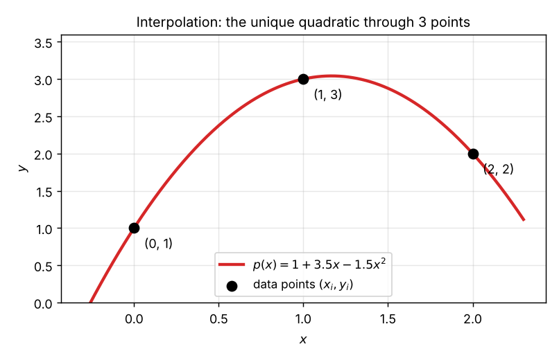
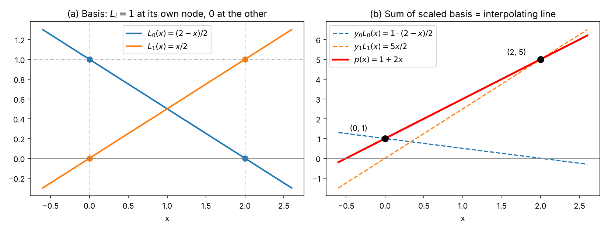
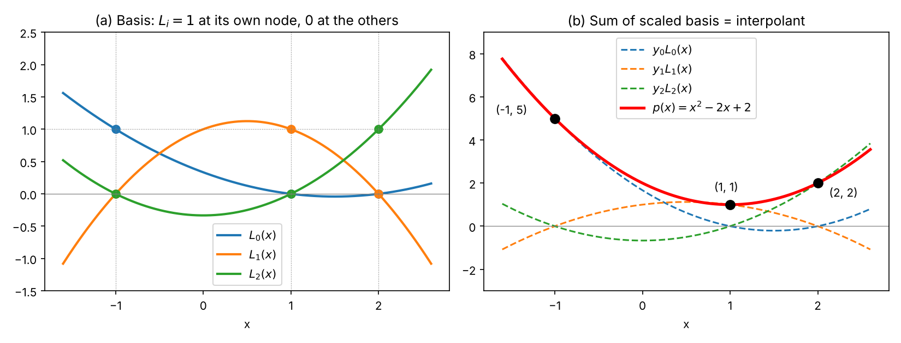
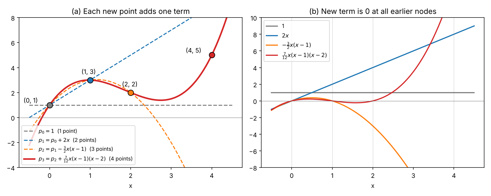
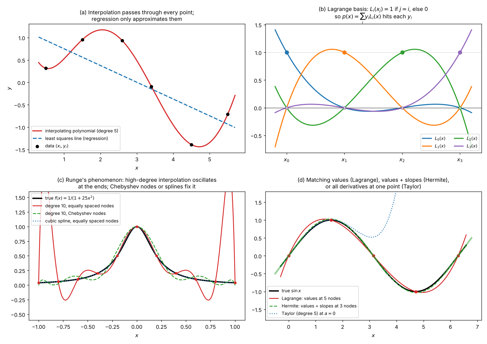
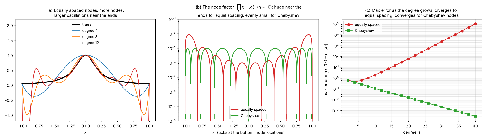
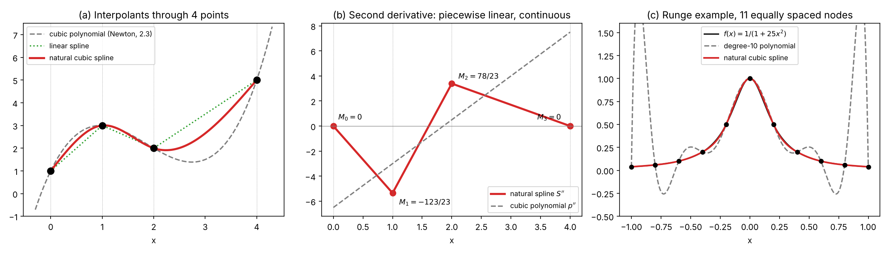

# Interpolation: Polynomial, Lagrange, Newton, Hermite and Taylor

**Summary.** Polynomial interpolation has one answer: a unique polynomial of degree at most $n$ through $n+1$ points. The monomial (Vandermonde), Lagrange and Newton forms are three ways of writing it. Hermite interpolation also matches derivatives (repeated nodes), and the Taylor polynomial is the extreme case where all conditions are placed at a single point.

## 1. Interpolation

Given points $(x_0, y_0), \dots, (x_n, y_n)$ with distinct $x_i$, find a function $p$ that passes **exactly** through them:

$$
p(x_i) = y_i, \qquad i = 0, 1, \dots, n .
$$

- **Interpolation** is for exact data (tabulated or computed values of a function).
- **Regression / smoothing** is for noisy data: it only approximates the points. A smoothing spline with $\lambda = 0$ is an interpolant.

## 2. Polynomial interpolation

For $n + 1$ distinct nodes there is **exactly one** polynomial of degree at most $n$ through them (proved in 2.1). Sections 2.1–2.3 write this one polynomial in three bases; 2.4–2.5 add derivative conditions.

### 2.1. The Vandermonde system

Write $p(x) = a_0 + a_1 x + a_2 x^2 + \cdots + a_n x^n$. Each condition $p(x_i) = y_i$ is a **linear** equation in the unknowns $a_0, \dots, a_n$ (the powers $x_i^k$ are known numbers):

$$
\begin{aligned}
a_0 + a_1 x_0 + a_2 x_0^2 + \cdots + a_n x_0^n &= y_0 \\
a_0 + a_1 x_1 + a_2 x_1^2 + \cdots + a_n x_1^n &= y_1 \\
&\ \ \vdots \\
a_0 + a_1 x_n + a_2 x_n^2 + \cdots + a_n x_n^n &= y_n
\end{aligned}
$$

In matrix form, $Va = y$:

$$
\underbrace{\begin{pmatrix}
1 & x_0 & x_0^2 & \cdots & x_0^n \\
1 & x_1 & x_1^2 & \cdots & x_1^n \\
\vdots & \vdots & \vdots & & \vdots \\
1 & x_n & x_n^2 & \cdots & x_n^n
\end{pmatrix}}_{V\ \text{(Vandermonde)}}
\begin{pmatrix} a_0 \\ a_1 \\ \vdots \\ a_n \end{pmatrix}
=
\begin{pmatrix} y_0 \\ y_1 \\ \vdots \\ y_n \end{pmatrix}.
$$

**Existence and uniqueness.** A square system has exactly one solution for every $y$ if and only if $\det V \ne 0$, and

$$
\det V = \prod_{0 \le i \lt  j \le n} (x_j - x_i),
$$

which is non-zero exactly when the nodes are **distinct**.

- **Why this determinant (sketch):** as a function of $x_n$, $\det V$ is a polynomial of degree $n$ whose leading coefficient is the Vandermonde determinant of $x_0, \dots, x_{n-1}$. It vanishes when $x_n = x_i$ ($i \lt  n$), since two rows are then equal. Hence $\det V(x_0, \dots, x_n) = \det V(x_0, \dots, x_{n-1})\prod_{i\lt n}(x_n - x_i)$; induction gives the product.
- **Without determinants:** if $Va = 0$, then $p(x) = \sum_k a_k x^k$ has $n + 1$ distinct roots. A non-zero polynomial of degree at most $n$ has at most $n$ roots, so $a = 0$: $V$ has a trivial null space and is invertible.

**Example** (points $(0, 1), (1, 3), (2, 2)$):

$$
\begin{pmatrix} 1 & 0 & 0 \\ 1 & 1 & 1 \\ 1 & 2 & 4 \end{pmatrix}
\begin{pmatrix} a_0 \\ a_1 \\ a_2 \end{pmatrix}
= \begin{pmatrix} 1 \\ 3 \\ 2 \end{pmatrix},
\qquad
\det V = (1 - 0)(2 - 0)(2 - 1) = 2 .
$$

Row 1 gives $a_0 = 1$; rows 2 and 3 give $a_1 + a_2 = 2$ and $2a_1 + 4a_2 = 1$, so $a_2 = -1.5$, $a_1 = 3.5$, and $p(x) = 1 + 3.5x - 1.5x^2$.



**Same polynomial, different bases.** Lagrange and Newton solve the same problem in other bases:

| Form | Basis functions | Matrix of the system | Solving |
|---|---|---|---|
| Monomial | $1, x, \dots, x^n$ | Vandermonde $V$ (dense) | Solve $Va = y$ |
| Newton | $1,\ (x - x_0),\ (x - x_0)(x - x_1), \dots$ | Lower triangular | Forward substitution (= divided differences) |
| Lagrange | $L_0(x), \dots, L_n(x)$ | Identity ($L_i(x_j) = \delta_{ij}$) | None: the coefficients are $y_i$ |

For large $n$ the columns $x^k$ become nearly parallel on an interval, so $V$ is ill-conditioned and solving $Va = y$ loses accuracy; this is why the Lagrange (barycentric) and Newton forms are preferred in practice.

### 2.2. Lagrange interpolation

$$
p(x) = \sum_{i=0}^{n} y_i\, L_i(x),
\qquad
L_i(x) = \prod_{j \ne i} \frac{x - x_j}{x_i - x_j}.
$$

- **Lagrange basis polynomials:** $L_i(x_j) = 1$ if $j = i$ and $0$ otherwise, so $p(x_i) = y_i$ automatically.
- **Pros:** explicit formula, no linear system. **Cons:** adding a point changes every $L_i$ (the barycentric form fixes this).

**Example (2 points).** $(x_0, y_0) = (0, 1)$, $(x_1, y_1) = (2, 5)$.

$$
L_0(x) = \frac{x - 2}{0 - 2} = \frac{2 - x}{2},
\qquad
L_1(x) = \frac{x - 0}{2 - 0} = \frac{x}{2},
\qquad
p(x) = 1\cdot\frac{2 - x}{2} + 5\cdot\frac{x}{2} = 1 + 2x .
$$

- Check: $p(0) = 1$, $p(2) = 5$.
- With 2 points, Lagrange interpolation is the straight line through them; $L_0$ and $L_1$ are the weights of linear interpolation, which add up to 1.



**Example (3 points).** $(x_0, y_0) = (-1, 5)$, $(x_1, y_1) = (1, 1)$, $(x_2, y_2) = (2, 2)$.

$$
L_0(x) = \frac{(x-1)(x-2)}{(-1-1)(-1-2)} = \frac{(x-1)(x-2)}{6},
\qquad
L_1(x) = \frac{(x+1)(x-2)}{(1+1)(1-2)} = -\frac{(x+1)(x-2)}{2},
\qquad
L_2(x) = \frac{(x+1)(x-1)}{(2+1)(2-1)} = \frac{(x+1)(x-1)}{3}.
$$

$$
p(x) = 5\,L_0(x) + 1\,L_1(x) + 2\,L_2(x)
= \frac{5(x^2 - 3x + 2) - 3(x^2 - x - 2) + 4(x^2 - 1)}{6}
= x^2 - 2x + 2 .
$$

- Check: $p(-1) = 5$, $p(1) = 1$, $p(2) = 2$.
- At $x = 1$, only $L_1$ is non-zero ($L_1(1) = 1$, $L_0(1) = L_2(1) = 0$), so $p(1) = y_1$; the same holds at each node.



In both figures, (a) shows that each $L_i$ equals 1 at its own node and 0 at the others, and (b) shows that the scaled terms $y_i L_i(x)$ (dashed) add up to the interpolant (red).

### 2.3. Newton polynomials (divided differences)

$$
p(x) = f[x_0] + f[x_0, x_1](x - x_0) + f[x_0, x_1, x_2](x - x_0)(x - x_1) + \cdots
$$

$$
f[x_i] = y_i, \qquad
f[x_i, \dots, x_{i+k}] = \frac{f[x_{i+1}, \dots, x_{i+k}] - f[x_i, \dots, x_{i+k-1}]}{x_{i+k} - x_i}.
$$

Adding a point adds **one term**; earlier coefficients stay the same.

**Divided-difference table.** Each column is computed from the column to its left: subtract the two neighbouring entries and divide by the difference of the outermost $x$'s they involve. The coefficients of $p(x)$ are the **top row**.

| $x_i$ | $f[x_i]$ | 1st order | 2nd order | 3rd order |
|---|---|---|---|---|
| $x_0$ | $f[x_0]$ | $f[x_0,x_1]$ | $f[x_0,x_1,x_2]$ | $f[x_0,x_1,x_2,x_3]$ |
| $x_1$ | $f[x_1]$ | $f[x_1,x_2]$ | $f[x_1,x_2,x_3]$ | |
| $x_2$ | $f[x_2]$ | $f[x_2,x_3]$ | | |
| $x_3$ | $f[x_3]$ | | | |

**Example (4 points).** $(0, 1)$, $(1, 3)$, $(2, 2)$, $(4, 5)$.

| $x_i$ | $f[x_i]$ | 1st order | 2nd order | 3rd order |
|---|---|---|---|---|
| 0 | **1** | $\frac{3-1}{1-0} = \mathbf{2}$ | $\frac{-1-2}{2-0} = \mathbf{-3/2}$ | $\frac{5/6-(-3/2)}{4-0} = \mathbf{7/12}$ |
| 1 | 3 | $\frac{2-3}{2-1} = -1$ | $\frac{3/2-(-1)}{4-1} = 5/6$ | |
| 2 | 2 | $\frac{5-2}{4-2} = 3/2$ | | |
| 4 | 5 | | | |

Reading the top row:

$$
p(x) = 1 + 2x - \tfrac{3}{2}\,x(x-1) + \tfrac{7}{12}\,x(x-1)(x-2)
= 1 + \tfrac{14}{3}x - \tfrac{13}{4}x^2 + \tfrac{7}{12}x^3 .
$$

- Check: $p(0) = 1$, $p(1) = 3$, $p(2) = 2$, $p(4) = 1 + 8 - 18 + 14 = 5$.
- The first three points are those of the example in 2.1, whose interpolant is $1 + 2x - \tfrac32 x(x-1) = 1 + 3.5x - 1.5x^2$. Adding $(4, 5)$ only adds the last row of the table and **one new term**, $\tfrac{7}{12}x(x-1)(x-2)$.



- **(a)** $p_0, p_1, p_2, p_3$ interpolate the first 1, 2, 3, 4 points. Each $p_k$ is $p_{k-1}$ plus one term, and keeps passing through the earlier points.
- **(b)** The new term $f[x_0,\dots,x_k]\prod_{i\lt k}(x - x_i)$ is zero at all earlier nodes, so adding it does not disturb the earlier fit; its coefficient is chosen to hit the new point.

#### Divided differences and derivatives

> **Rolle's theorem.** If $g$ is continuous on $[a, b]$, differentiable on $(a, b)$, and $g(a) = g(b)$, then $g'(c) = 0$ for some $c \in (a, b)$: between two points at the same height, a smooth curve has a horizontal tangent.
>
> **Applied repeatedly.** If $g$ has $k+1$ distinct zeros, Rolle's theorem between each pair of neighbouring zeros gives $k$ zeros of $g'$, then $k-1$ zeros of $g''$, …, and finally **one zero of $g^{(k)}$**.

**Result.** A divided difference behaves like a derivative divided by a factorial:

$$
f[x_0, x_1, \dots, x_k] = \frac{f^{(k)}(\xi)}{k!}
\qquad \text{for some } \xi \text{ between } \min_i x_i \text{ and } \max_i x_i .
$$

- **$k = 1$:** $f[x_0, x_1] = \dfrac{f(x_1) - f(x_0)}{x_1 - x_0} = f'(\xi)$, the slope of the secant line. This is the mean value theorem (Rolle's theorem applied to $f$ minus its secant line).
- **General $k$ (proof):** let $p_k$ interpolate $f$ at $x_0,\dots,x_k$; its leading coefficient is $f[x_0,\dots,x_k]$, so $p_k^{(k)} = k!\,f[x_0,\dots,x_k]$ (a constant). $g = f - p_k$ is zero at the $k+1$ nodes, so by Rolle's theorem applied repeatedly, $0 = g^{(k)}(\xi) = f^{(k)}(\xi) - k!\,f[x_0,\dots,x_k]$.
- **Coinciding nodes:** as all nodes tend to $a$, $\xi \to a$, so $f[x_0, \dots, x_k] \to f^{(k)}(a)/k!$; in particular $f[x_0, x_1] \to f'(a)$. This defines $f[x_i, x_i] = f'(x_i)$ for **Hermite** interpolation (2.4).
- **Newton → Taylor:** with all nodes at $a$, the Newton form becomes the **Taylor polynomial** (2.5). The Newton form is a "discrete Taylor expansion":

| Newton form | Taylor form |
|---|---|
| $f[x_0]$ | $f(a)$ |
| $f[x_0, x_1]$ | $f'(a)$ |
| $f[x_0, x_1, x_2]$ | $f''(a)/2!$ |
| $f[x_0, \dots, x_k]$ | $f^{(k)}(a)/k!$ |
| $\prod_{i\lt k}(x - x_i)$ | $(x - a)^k$ |

- **Example 1 (polynomial).** For $f(x) = x^3$ at $0, 1, 2$: $f[0,1] = 1$, $f[1,2] = 7$, $f[0,1,2] = (7-1)/2 = 3 = f''(\xi)/2! = 3\xi$ with $\xi = 1$. Any third divided difference of $x^3$ equals $f'''/3! = 1$, its leading coefficient. Likewise, in the 4-point example above, $p$ is cubic with $p''' = 7/2$, and $f[0,1,2,4] = 7/12 = p'''/3!$.
- **Example 2 (nodes coming together).** For $f(x) = e^x$ at $0, h, 2h$ (exact values $f'(0) = 1$, $f''(0)/2! = 0.5$):

| $h$ | $f[0, h]$ | $f[0, h, 2h]$ |
|---|---|---|
| 1 | 1.718 | 1.476 |
| 0.1 | 1.052 | 0.553 |
| 0.01 | 1.005 | 0.505 |
| $\to 0$ | $f'(0) = 1$ | $f''(0)/2! = 0.5$ |

### 2.4. Hermite interpolation

Match **values and derivatives**: $p(x_i) = f(x_i)$ and $p'(x_i) = f'(x_i)$.

- $2(n+1)$ conditions give a unique polynomial of degree at most $2n + 1$.
- Use Newton's form with **repeated nodes**: $f[x_i, x_i] = f'(x_i)$, and in general $f[x_i, \dots, x_i] = f^{(k)}(x_i)/k!$ ($k+1$ copies), the limits in 2.3.
- Piecewise cubic Hermite interpolation is the building block of cubic splines (Section 6).

### 2.5. Taylor polynomials

All conditions at **one point** $a$:

$$
p(x) = \sum_{k=0}^{n} \frac{f^{(k)}(a)}{k!}(x - a)^k .
$$

- This is Hermite interpolation with **one node repeated $n+1$ times**.
- Very accurate near $a$, possibly poor far away (error in Section 5).

## 3. Illustrations



- **(a) Interpolation vs regression:** the interpolating polynomial (red) passes through every point; the least squares line (dashed) only approximates them.
- **(b) Lagrange basis:** see 2.2.
- **(c) Runge's phenomenon:** for $f(x) = 1/(1 + 25x^2)$ with 11 equally spaced nodes, the degree-10 polynomial (red) oscillates near the ends; Chebyshev nodes (green dashed) or a cubic spline (blue dotted) follow the true curve (Section 5).
- **(d) What is matched:** for $\sin x$, Lagrange matches values at 5 nodes, Hermite matches values and slopes at 3 nodes, and the degree-5 Taylor polynomial matches all derivatives at $x = 0$: excellent near 0, poor far away.

## 4. How they are related

```
Interpolation (pass through data)
 └─ Polynomial interpolation: unique p of degree ≤ n
      ├─ Monomial form   (Vandermonde system)
      ├─ Lagrange form   p = Σ y_i L_i(x)      ┐ same polynomial,
      └─ Newton form     divided differences   ┘ different bases
            └─ nodes coincide (match derivatives) → Hermite
                 └─ all conditions at one point   → Taylor
 └─ Piecewise polynomial interpolation → splines (linear, cubic)
```

| | Conditions | Nodes | Degree | Main use |
|---|---|---|---|---|
| Lagrange | Values | $n+1$ distinct | $\le n$ | Explicit formula; theory, quadrature |
| Newton | Values | $n+1$ distinct | $\le n$ | Adding points; hand computation |
| Hermite | Values + derivatives | Distinct nodes, each counted twice | $\le 2n+1$ | Smooth interpolation; splines |
| Taylor | Value + derivatives up to order $n$ | One point, repeated $n+1$ times | $\le n$ | Local approximation |

All share the same error form (Section 5).

## 5. Interpolation error and Runge's phenomenon

If $y_i = f(x_i)$ and $f$ has $n+1$ continuous derivatives, then for each $x$ there is a $\xi$ between the nodes and $x$ with

$$
f(x) - p_n(x) = \underbrace{\frac{f^{(n+1)}(\xi)}{(n+1)!}}_{\text{depends on } f}\ \times\ \underbrace{\prod_{i=0}^{n}(x - x_i)}_{\text{depends only on the nodes}} .
$$

- **Proof:** add $x$ as an extra node. By the Newton form, $f(x) - p_n(x) = f[x_0, \dots, x_n, x]\prod_{i}(x - x_i)$, and $f[x_0, \dots, x_n, x] = f^{(n+1)}(\xi)/(n+1)!$ by 2.3 (Rolle's theorem).
- The error is the same for the Vandermonde, Lagrange and Newton forms, since they give the same polynomial.
- **Taylor** (all nodes at $a$): $f(x) - p(x) = \dfrac{f^{(n+1)}(\xi)}{(n+1)!}(x - a)^{n+1}$. **Hermite:** each node appears twice in the product.

**Runge's phenomenon.** With many equally spaced nodes, the polynomial oscillates near the ends. Remedies: Chebyshev nodes, or piecewise low-degree polynomials (**splines**).



With equally spaced nodes, both factors of the error work against us (figures for $f(x) = 1/(1 + 25x^2)$ on $[-1, 1]$):

- **The node factor is huge near the ends (b).** For equally spaced nodes, the bumps of $|\prod_i (x - x_i)|$ are about 100 times larger near $\pm 1$ than in the middle, because an end point is far from most other nodes. Chebyshev nodes, $x_i = \cos\!\big(\tfrac{(2i+1)\pi}{2(n+1)}\big)$, cluster toward the ends and make all bumps the same height, $2^{-n}$, the smallest possible maximum.
- **The derivative factor grows.** $1/(1 + 25x^2)$ has complex poles at $\pm i/5$, close to the interval, so $f^{(n+1)}(\xi)/(n+1)!$ grows like $5^{n+1}$ instead of shrinking.
- **(a) More nodes make it worse:** degree 4, 8, 12 interpolants on equally spaced nodes fit the middle but swing more and more near the ends.
- **(c) Divergence vs convergence:** the maximum error over $[-1, 1]$:

| Degree $n$ | Equally spaced | Chebyshev |
|---|---|---|
| 4 | 0.44 | 0.40 |
| 8 | 1.05 | 0.17 |
| 12 | 3.66 | 0.069 |
| 20 | 59.8 | 0.015 |
| 40 | about 105,000 | 0.00029 |

**Why splines also fix it (Section 6):** a spline keeps the degree low (e.g., cubic) and adds flexibility through more pieces. On each short interval, the error involves only a low-order derivative and a product of a few small distances, so it shrinks as the pieces get shorter.

## 6. Spline interpolation

### 6.1. Idea

Section 5 shows that one high-degree polynomial through many nodes can oscillate badly. A **spline** uses **many low-degree pieces** instead: on each interval $[x_i, x_{i+1}]$ it is a polynomial of low degree, and the pieces are joined smoothly at the nodes (called **knots**).

- Nodes $x_0 \lt  x_1 \lt  \cdots \lt  x_n$, intervals of length $h_i = x_{i+1} - x_i$, $h = \max_i h_i$.
- A spline of degree $d$ is a polynomial of degree $\le d$ on each interval, with continuous derivatives up to order $d - 1$ at the knots.
- Flexibility comes from **more pieces**, not higher degree, so the error shrinks as $h \to 0$ for fixed $d$.

### 6.2. Linear spline

Join neighbouring points by straight lines: on $[x_i, x_{i+1}]$ it is the 2-point Lagrange interpolant of 2.2,

$$
S(x) = y_i\,\frac{x_{i+1} - x}{h_i} + y_{i+1}\,\frac{x - x_i}{h_i} .
$$

- Continuous, but the slope jumps at the knots (a "broken line").
- Error from Section 5 with $n = 1$: $|f(x) - S(x)| \le \dfrac{h^2}{8}\max|f''|$, i.e. $O(h^2)$.

### 6.3. Cubic spline

**Definition.** $S$ is a cubic polynomial $S_i$ on each $[x_i, x_{i+1}]$, with

$$
S(x_i) = y_i, \qquad S \in C^2 \ \ (S,\ S',\ S'' \text{ continuous at the knots}).
$$

The second derivative is continuous, so the curve has no visible corners or jumps in curvature; this is why it looks smooth.

**Counting conditions.** $n$ intervals × 4 coefficients = $4n$ unknowns.

| Condition | Number |
|---|---|
| Each piece passes through both end points of its interval ($S_i(x_i) = y_i$, $S_i(x_{i+1}) = y_{i+1}$) | $2n$ |
| $S'$ continuous at the interior knots | $n - 1$ |
| $S''$ continuous at the interior knots | $n - 1$ |
| **Total** | $4n - 2$ |

Two conditions are missing, so two **boundary conditions** are added:

| Boundary condition | Extra conditions | Remark |
|---|---|---|
| **Natural** | $S''(x_0) = S''(x_n) = 0$ | Straight at the ends; used by smoothing splines |
| **Clamped** | $S'(x_0) = f'(x_0)$, $S'(x_n) = f'(x_n)$ | Needs known end slopes (Hermite-type) |
| **Not-a-knot** | $S'''$ continuous at $x_1$ and $x_{n-1}$ | Default in MATLAB / SciPy; with 4 points it gives the cubic polynomial |
| **Periodic** | $S'(x_0) = S'(x_n)$, $S''(x_0) = S''(x_n)$ | For periodic data with $y_0 = y_n$ |

**Computing it: a tridiagonal system.** Let $M_i = S''(x_i)$ (the "moments"). On each interval $S''$ is linear, so

$$
S''(x) = M_i\,\frac{x_{i+1} - x}{h_i} + M_{i+1}\,\frac{x - x_i}{h_i} \qquad (x_i \le x \le x_{i+1}),
$$

which is the linear spline of the $M_i$, so $S''$ is automatically continuous. Integrating twice and imposing $S(x_i) = y_i$, $S(x_{i+1}) = y_{i+1}$:

$$
S_i(x) = \frac{M_i (x_{i+1} - x)^3 + M_{i+1}(x - x_i)^3}{6h_i}
+ \Big(y_i - \frac{M_i h_i^2}{6}\Big)\frac{x_{i+1} - x}{h_i}
+ \Big(y_{i+1} - \frac{M_{i+1} h_i^2}{6}\Big)\frac{x - x_i}{h_i}.
$$

Requiring $S'$ to be continuous at $x_1, \dots, x_{n-1}$ gives $n - 1$ linear equations:

$$
h_{i-1} M_{i-1} + 2(h_{i-1} + h_i) M_i + h_i M_{i+1}
= 6\big(f[x_i, x_{i+1}] - f[x_{i-1}, x_i]\big)
= 6(h_{i-1} + h_i)\, f[x_{i-1}, x_i, x_{i+1}] ,
$$

with the divided differences of 2.3 on the right. Each equation involves only three neighbouring $M$'s, so the matrix is **tridiagonal** (and diagonally dominant): it is well-conditioned and solved in $O(n)$ operations, unlike the dense Vandermonde system of 2.1. Natural boundary conditions set $M_0 = M_n = 0$.

**Example (natural cubic spline, 4 points).** The points of the Newton example in 2.3: $(0, 1), (1, 3), (2, 2), (4, 5)$, so $h_0 = 1$, $h_1 = 1$, $h_2 = 2$ and $M_0 = M_3 = 0$. From the divided-difference table, $f[0,1,2] = -3/2$ and $f[1,2,4] = 5/6$:

$$
\begin{pmatrix} 2(1 + 1) & 1 \\ 1 & 2(1 + 2) \end{pmatrix}
\begin{pmatrix} M_1 \\ M_2 \end{pmatrix}
=
\begin{pmatrix} 6 \cdot 2 \cdot (-3/2) \\ 6 \cdot 3 \cdot 5/6 \end{pmatrix}
=
\begin{pmatrix} -18 \\ 15 \end{pmatrix}
\ \Longrightarrow\
M_1 = -\frac{123}{23} \approx -5.35,\quad M_2 = \frac{78}{23} \approx 3.39 .
$$

Substituting into $S_i(x)$ (with $t = x - x_i$):

| Interval | $S_i(x)$ |
|---|---|
| $[0, 1]$ | $1 + 2.891\,t - 0.891\,t^3$ |
| $[1, 2]$ | $3 + 0.217\,t - 2.674\,t^2 + 1.457\,t^3$ |
| $[2, 4]$ | $2 - 0.761\,t + 1.696\,t^2 - 0.283\,t^3$ |

- Check: each piece hits its two end points, and the values of $S'$ and $S''$ agree where pieces meet.
- With the **not-a-knot** condition instead, the 4-point spline is the single cubic $p(x) = 1 + \tfrac{14}{3}x - \tfrac{13}{4}x^2 + \tfrac{7}{12}x^3$ of 2.3.



- **(a)** The linear spline has corners; the natural cubic spline is smooth and on $[2, 4]$ it dips much less than the cubic polynomial.
- **(b)** $S''$ is continuous and piecewise linear through the $M_i$, with $M_0 = M_3 = 0$ (natural). The cubic polynomial's $p''$ is a single straight line.
- **(c)** On the Runge function, the degree-10 polynomial oscillates near the ends, while the natural cubic spline through the same 11 nodes follows $f$ closely.

### 6.4. Properties

- **Error.** For smooth $f$ (clamped or not-a-knot conditions), $\max|f - S| \le \dfrac{5}{384}\,h^4 \max|f^{(4)}|$, i.e. $O(h^4)$: halving $h$ divides the error by about 16. The natural condition forces $S'' = 0$ at the ends, which adds an $O(h^2)$ error near the ends unless $f'' = 0$ there.
- **Convergence on the Runge function** (equally spaced nodes on $[-1, 1]$, maximum error; compare the polynomial in Section 5):

| $n$ (intervals) | Linear spline | Natural cubic spline |
|---|---|---|
| 4 | 0.18 | 0.28 |
| 8 | 0.064 | 0.056 |
| 12 | 0.065 | 0.0069 |
| 20 | 0.042 | 0.0032 |
| 40 | 0.014 | 0.00028 |
| 80 | 0.0038 | 0.000016 |

- **Minimum curvature.** Among all functions $g$ with continuous $g''$ that pass through the data, the natural cubic spline minimizes the total curvature $\int_{x_0}^{x_n} g''(x)^2\,dx$. This is the mathematical form of a draftsman's flexible ruler (the original "spline") bent through pins at the data points.
- **Local changes.** Changing one $y_i$ changes the whole spline, but the effect decays quickly away from $x_i$ (unlike a global polynomial, where it does not decay).

### 6.5. Relation to Hermite interpolation and to regression

- **Piecewise cubic Hermite (2.4)** also uses one cubic per interval, but with **given** slopes $f'(x_i)$: the result is only $C^1$. The cubic spline instead **chooses** the slopes (through the tridiagonal system) so that $S''$ is also continuous: $C^2$, and no derivative data needed.
- **Regression splines (ISLP 7.4):** use fewer knots than data points and fit by least squares, e.g. with the basis $1, x, x^2, x^3, (x - \xi_1)_+^3, \dots, (x - \xi_K)_+^3$ ($K + 4$ degrees of freedom). The interpolating spline is the special case with a knot at every data point and zero residuals.
- **Smoothing splines (ISLP 7.5):** minimize $\sum_i (y_i - g(x_i))^2 + \lambda \int g''(t)^2\,dt$. The solution is a natural cubic spline with knots at every $x_i$. As $\lambda \to 0$ it becomes the interpolating natural cubic spline above (by the minimum-curvature property); as $\lambda \to \infty$ it becomes the least squares line.
